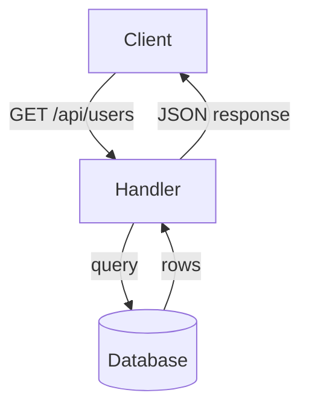

## Diagram-First PR Summary Generation

Part of `iv-review-build-and-pr` (Station IV). Loaded on demand — the
step contract in `SKILL.md` is the source of truth; this file holds the detail.

### Goal

Before writing the PR body, generate the **smallest visual that makes the
change clear** — a diagram, file tree, pseudocode, or call tree — and place
it as the **first** element of `## Summary`. Prose becomes the fallback
explanation below the visual, never the leading summary.

### Step 5a: Classify the Change Type

Inspect `git diff --name-only origin/<base>...HEAD` and the diff content.
Pick the **single best** diagram type:

| Change Type | Signals | Diagram Type |
|---|---|---|
| **API / interface change** | `.ts`/`.js` `.d.ts` export signatures, route definitions, OpenAPI/Swagger | Mermaid flowchart (contract) |
| **New feature / module** | New files or directories, new exported functions | File tree + call tree (pseudocode) |
| **Refactor (no behavior change)** | Renamed symbols, moved functions, internal restructuring | File-tree diff (before/after) |
| **Bug fix** | Changes to logic branches, conditional fixes | State transition (before → after) |
| **UI change** | `.tsx`/`.jsx`/`css`, template/render logic | Before/after screenshot (playwright-cli) |
| **Config / docs only** | `.json`/`.yaml`/`.md` only, no code | Inline diff snippet |

### Step 5b: Generate the Diagram

#### API / interface change → Mermaid contract diagram



Extract exported function signatures from the diff:
```bash
git diff --name-only origin/<base>...HEAD | xargs -I{} rg "^export" {}
```

Render each as a Mermaid node. Draw call edges by tracing `import` chains
in the modified files.

#### New feature / module → File tree + call tree

```
src/
├── auth/              [NEW]
│   ├── middleware.ts  (AuthMiddleware)
│   └── session.ts     (createSession, validateSession)
└── api/
    └── routes.ts      → imports AuthMiddleware
```

Pseudocode call tree:
```
POST /login
  → AuthMiddleware.verify(req)
    → validateSession()
      → returns { user, token }
```

#### Refactor → File-tree diff (before/after)

Show only files that moved, were renamed, or had symbols extracted:
```
Before:   src/utils/format.ts (formatDate, formatCurrency, formatBytes)
After:    src/utils/date.ts (formatDate)       [NEW]
          src/utils/currency.ts (formatCurrency) [NEW]
          src/utils/format.ts (formatBytes)      [KEPT]
```

Generate with:
```bash
git diff --name-status origin/<base>...HEAD
```

#### Bug fix → State transition

```
Before: [idle] --(click save)--> [saving] --(API fail)--> [idle]  ❌ (silently drops)
After:  [idle] --(click save)--> [saving] --(API fail)--> [error: "retry"]  ✅
```

#### UI change → Before/after screenshot

Use `playwright-cli screenshot --before` (checkout base) and `--after`
(checkout HEAD), place both side by side:

```markdown
| Before | After |
|--------|-------|
|  |  |
```

#### Config / docs only → Inline diff

```diff
- "timeout": 5000
+ "timeout": 10000
```

### Rules

- The diagram must fit on one screen without vertical scrolling. If it
  does not, decompose into a file-tree summary + a single focused diagram.
- Mermaid diagrams must be valid GitHub-flavored Mermaid. Test by piping
  through `mmdc` if available; otherwise eyeball syntax.
- If no diagram type fits (e.g., a one-line config change), use an inline
  diff snippet and skip the visual section.
- The visual replaces the first paragraph of `## Summary`. If the operator
  explicitly requests "no diagram," produce prose instead and note the skip.
